<div align="center">

  <a href="https://bapanghosh.netlify.app/">
    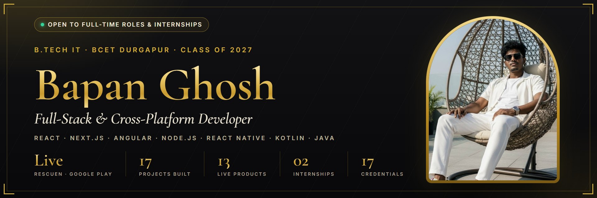
  </a>

  <br/><br/>

  <a href="https://bapanghosh.netlify.app/">
    
  </a>

  <br/>

  <p align="center">
    <a href="https://bapanghosh.netlify.app/" target="_blank"></a>&nbsp;
    <a href="https://play.google.com/store/apps/details?id=com.officialrescuen.app" target="_blank"></a>&nbsp;
    <a href="https://www.linkedin.com/in/bapan-ghosh-5676803a2/" target="_blank"></a>&nbsp;
    <a href="https://leetcode.com/u/BAPAN_GHOSH_07/" target="_blank"></a>&nbsp;
    <a href="https://bapanghosh.netlify.app/Bapan_Ghosh_Resume.pdf" target="_blank"></a>&nbsp;
    <a href="mailto:bapanghosh081204@gmail.com"></a>&nbsp;
    <a href="https://wa.me/919883290273?text=Hello%20Bapan!" target="_blank"></a>
  </p>

  <br/>

  <a href="https://bapanghosh.netlify.app/">
    
  </a>
  <br/>
  <sub>◆ &nbsp;LIVE · BAPAN'S LOCAL TIME · BANKURA, INDIA (IST)&nbsp; ◆</sub>

  <br/><br/>

  <p align="center">
    <sub>
      <a href="#-about-me">About</a> &nbsp;·&nbsp;
      <a href="#-latest-updates">Updates</a> &nbsp;·&nbsp;
      <a href="#-featured-work">Featured Work</a> &nbsp;·&nbsp;
      <a href="#-all-projects--live-demos">All Projects</a> &nbsp;·&nbsp;
      <a href="#-architecture-notes">Architecture</a> &nbsp;·&nbsp;
      <a href="#-skills--tech-stack">Skills</a> &nbsp;·&nbsp;
      <a href="#-experience--journey">Journey</a> &nbsp;·&nbsp;
      <a href="#-certifications--credentials">Credentials</a> &nbsp;·&nbsp;
      <a href="#-activity--analytics">Activity</a> &nbsp;·&nbsp;
      <a href="#-arcade--take-a-break">Arcade</a> &nbsp;·&nbsp;
      <a href="#-get-in-touch">Contact</a>
    </sub>
  </p>

  

</div>

## ✦ About Me

I'm a final-year B.Tech Information Technology student at Bengal College of Engineering and Technology, Durgapur (Class of 2027) — and a developer who loves shipping things end to end: the interface, the mobile client, the API, the database and the deployment.

I co-built and launched Rescuen on the Google Play Store, where I owned the Android app — React Native with custom Kotlin native modules for lock-screen SOS. Since then I've built a verified campus network with WebRTC live video, an offline-capable UPI engine on Android StrongBox and Go, a Fire TV storytelling app on Amazon Bedrock, and AI products on Angular, React and Next.js.

Security, performance and accessibility matter to me as much as looks — rate limits, CSP, tests and Lighthouse scores are part of “done”. I'm open to full-time SDE and full-stack roles as well as internships, where I can ship real features and learn from great engineers.

| Snapshot | Details |
| :--- | :--- |
| **Status** | **Available now for full-time roles and internships — remote or on-site, anywhere in India** |
| **Looking for** | Full-time Software Engineer / SDE · Full-Stack Developer (React, Next.js, Node.js) · Mobile Developer (React Native, Kotlin, Flutter) · Software engineering internships · Backend / Cloud roles |
| **Education** | B.Tech in Information Technology — Bengal College of Engineering and Technology (BCET), Durgapur (MAKAUT, West Bengal) · Aug 2023 – Jun 2027 |
| **Core stack** | `React` `Next.js` `Angular` `TypeScript` `Node.js` `Express` `React Native` `Kotlin` `Java` `Python` `MongoDB` `PostgreSQL` `Firebase` `Docker` |
| **By the numbers** | **17** projects built · **13** live products & demos · **2** industry internships · **17** certificates & credentials |
| **Languages** | English · Hindi · Bengali |
| **Links** | [Live portfolio ↗](https://bapanghosh.netlify.app/) · [Résumé (PDF) ↗](https://bapanghosh.netlify.app/Bapan_Ghosh_Resume.pdf) · [Rescuen on Google Play ↗](https://play.google.com/store/apps/details?id=com.officialrescuen.app) |

<div align="center">
  
</div>

## ✦ Latest Updates

| Date | What's new |
| :--- | :--- |
| `21 Nov 2026` | Rebuilt this portfolio — new noir & gold design, Mini Bapan assistant and a live GitHub feed. |
| `18 Nov 2026` | Launched Vitrine, an AI product-card generator on Angular 22 (Lighthouse 97–100, 184 tests). |
| `03 Nov 2026` | Shipped Fresnel, a website accessibility & performance checker on Angular 19. |
| `01 Nov 2026` | Released Wizard Chess 3D — Three.js chess with an AI opponent. |
| `31 Oct 2026` | Completed Wipro TalentNext — Java Full Stack (Jul–Oct 2026). |
| `06 Oct 2026` | Began Fortress UPI — hardware-attested offline payments on Android StrongBox and Go. |

<div align="center">
  
</div>

## ✦ Featured Work

<table width="100%">
  <tr>
    <td width="50%" valign="top">
      <a href="https://play.google.com/store/apps/details?id=com.officialrescuen.app" target="_blank">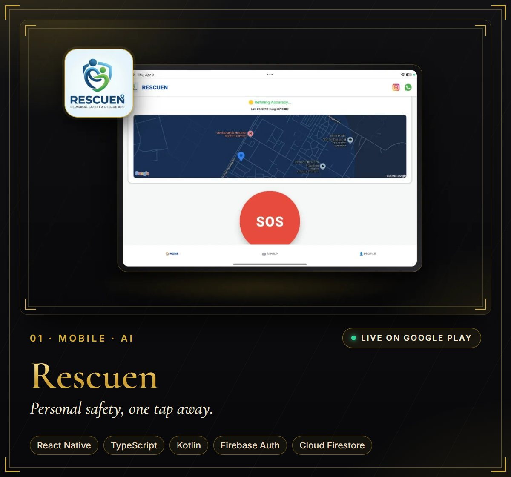</a>
      <p align="center"><sub>Android app · Team of two</sub><br/><a href="https://play.google.com/store/apps/details?id=com.officialrescuen.app"><b>Play Store ↗</b></a> &nbsp;·&nbsp; <a href="https://rescuen-web.netlify.app/"><b>Live ↗</b></a> &nbsp;·&nbsp; <a href="https://github.com/bapanghosh0812/RESCUEN"><b>Code ↗</b></a></p>
    </td>
    <td width="50%" valign="top">
      <a href="https://the-college-campus.netlify.app/" target="_blank">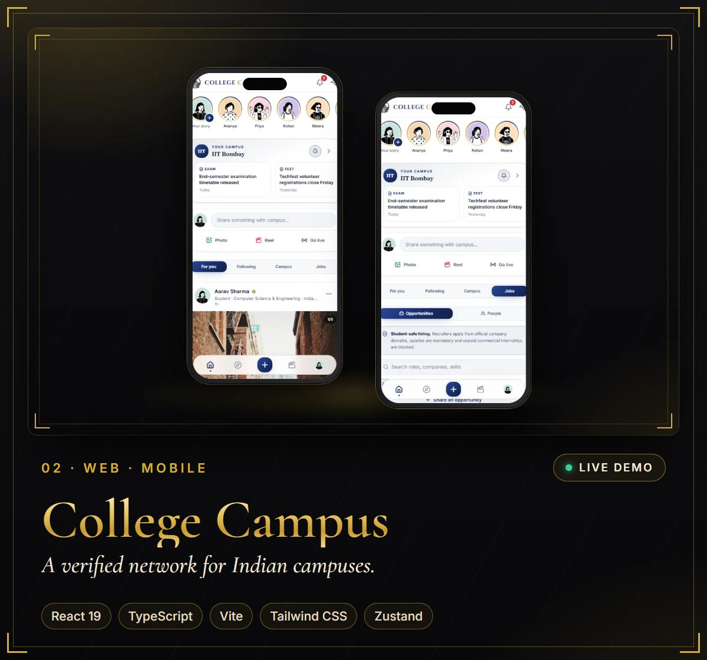</a>
      <p align="center"><sub>Full-stack social platform · Web, Android & iOS</sub><br/><a href="https://the-college-campus.netlify.app/"><b>Live ↗</b></a> &nbsp;·&nbsp; <a href="https://github.com/bapanghosh0812/Social-App"><b>Code ↗</b></a></p>
    </td>
  </tr>
  <tr>
    <td width="50%" valign="top">
      <a href="https://github.com/bapanghosh0812/FORTRESS-UPI" target="_blank">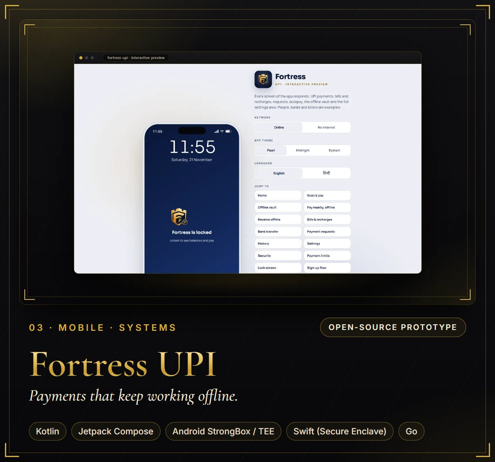</a>
      <p align="center"><sub>Fintech · Security engineering</sub><br/><a href="https://github.com/bapanghosh0812/FORTRESS-UPI"><b>Code ↗</b></a> &nbsp;·&nbsp; <a href="https://github.com/bapanghosh0812/FORTRESS-UPI/blob/main/docs/ARCHITECTURE.md"><b>Docs ↗</b></a></p>
    </td>
    <td width="50%" valign="top">
      <a href="https://github.com/bapanghosh0812/Fire-TV-Amazon" target="_blank">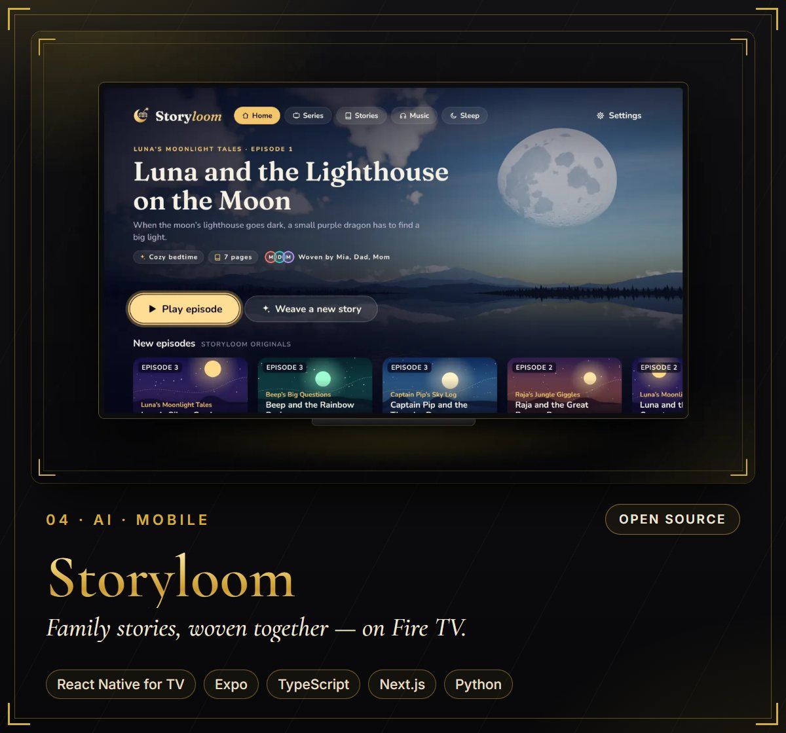</a>
      <p align="center"><sub>Fire TV app · Multi-agent generative AI</sub><br/><a href="https://github.com/bapanghosh0812/Fire-TV-Amazon"><b>Code ↗</b></a></p>
    </td>
  </tr>
  <tr>
    <td width="50%" valign="top">
      <a href="https://vitrine-ai-product-cards.vercel.app" target="_blank">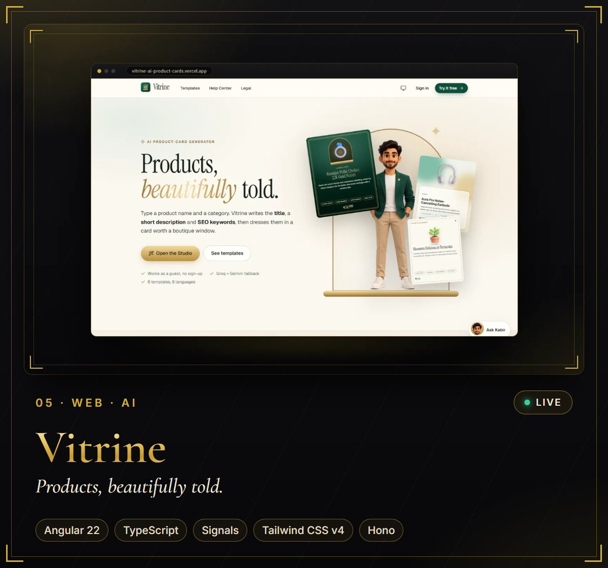</a>
      <p align="center"><sub>AI product-card generator · Angular 22</sub><br/><a href="https://vitrine-ai-product-cards.vercel.app"><b>Live ↗</b></a> &nbsp;·&nbsp; <a href="https://github.com/bapanghosh0812/vitrine-ai-product-cards"><b>Code ↗</b></a></p>
    </td>
    <td width="50%" valign="top">
      <a href="https://note-taking-app-tau-smoky.vercel.app" target="_blank">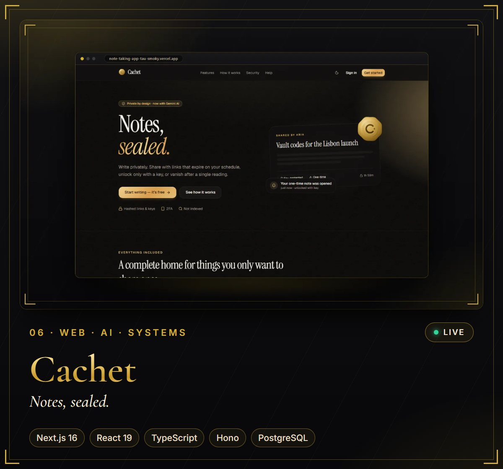</a>
      <p align="center"><sub>Secure note sharing · Next.js 16 + PostgreSQL</sub><br/><a href="https://note-taking-app-tau-smoky.vercel.app"><b>Live ↗</b></a> &nbsp;·&nbsp; <a href="https://github.com/bapanghosh0812/Note-Taking-App"><b>Code ↗</b></a></p>
    </td>
  </tr>
  <tr>
    <td width="50%" valign="top">
      <a href="https://chatbot-or-mini-chatgpt.netlify.app/" target="_blank">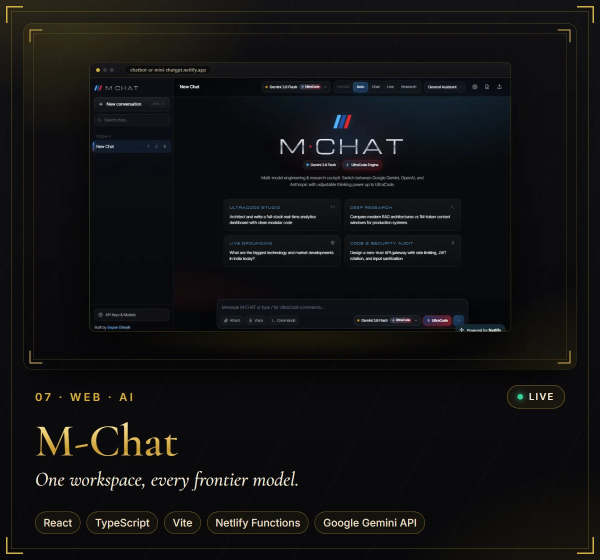</a>
      <p align="center"><sub>Multi-agent AI workspace</sub><br/><a href="https://chatbot-or-mini-chatgpt.netlify.app/"><b>Live ↗</b></a> &nbsp;·&nbsp; <a href="https://github.com/bapanghosh0812/M-Chat"><b>Code ↗</b></a></p>
    </td>
    <td width="50%" valign="top">
      <a href="https://official-wearsuper-cloth-store.netlify.app/" target="_blank">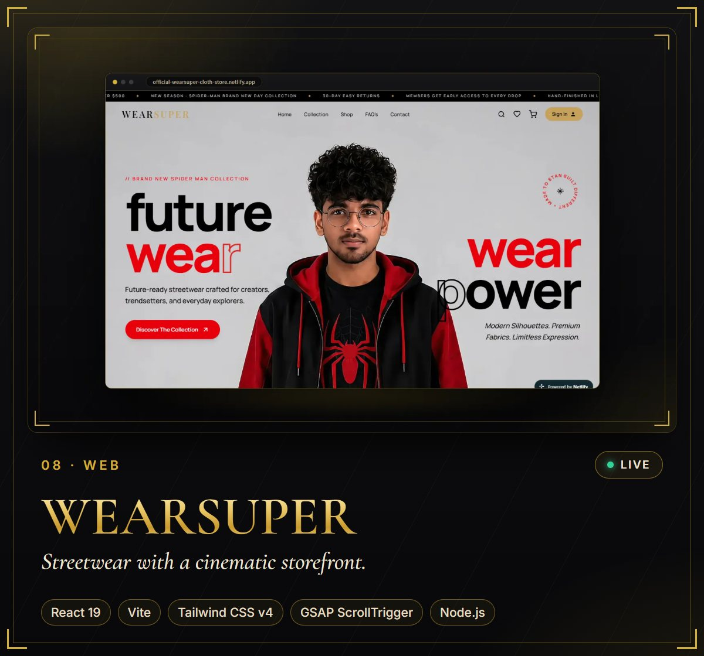</a>
      <p align="center"><sub>MERN e-commerce</sub><br/><a href="https://official-wearsuper-cloth-store.netlify.app/"><b>Live ↗</b></a> &nbsp;·&nbsp; <a href="https://github.com/bapanghosh0812/cloth"><b>Code ↗</b></a></p>
    </td>
  </tr>
  <tr>
    <td width="50%" valign="top">
      <a href="https://website-performance-checker.netlify.app/" target="_blank">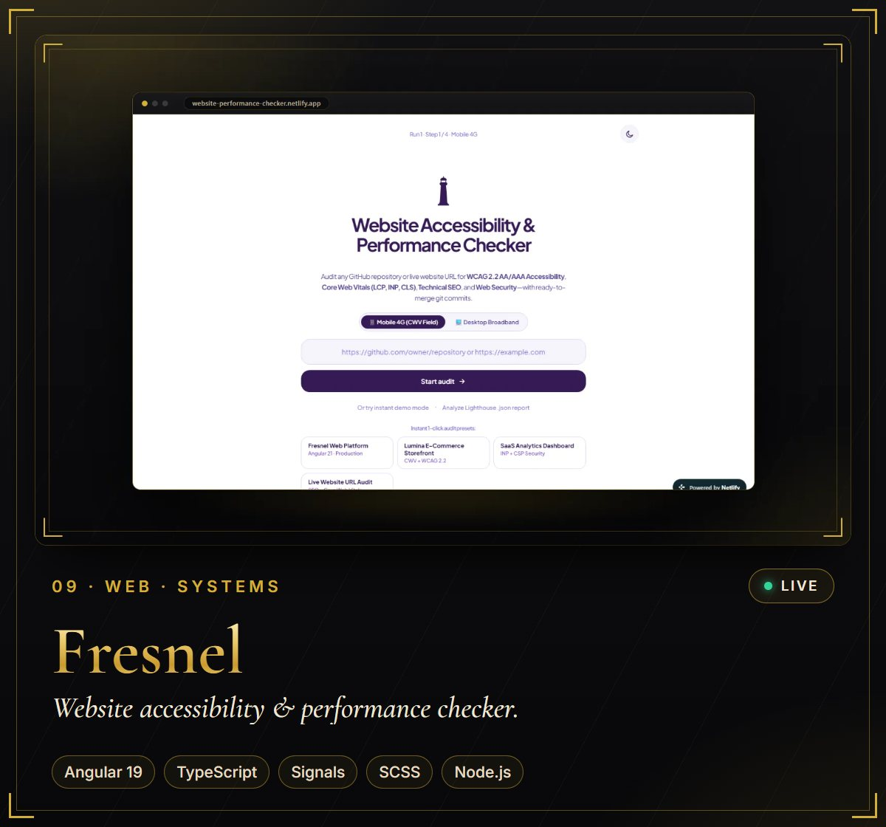</a>
      <p align="center"><sub>Web audit tool · Angular 19 + Node</sub><br/><a href="https://website-performance-checker.netlify.app/"><b>Live ↗</b></a> &nbsp;·&nbsp; <a href="https://github.com/bapanghosh0812/Website-Accessibility-Performance-Checker"><b>Code ↗</b></a></p>
    </td>
    <td width="50%" valign="top">
      <a href="https://children-s-coloring-book-generator.netlify.app/" target="_blank">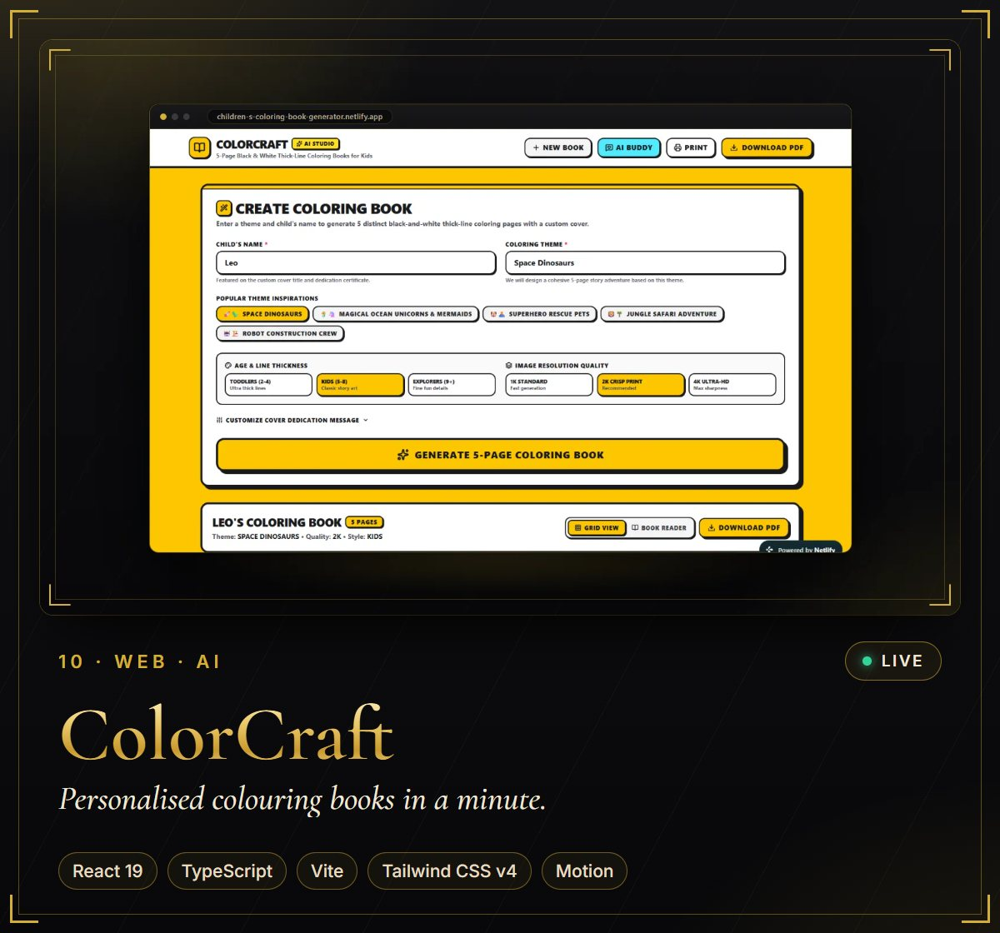</a>
      <p align="center"><sub>Generative-AI web app</sub><br/><a href="https://children-s-coloring-book-generator.netlify.app/"><b>Live ↗</b></a> &nbsp;·&nbsp; <a href="https://github.com/bapanghosh0812/Children-s-Coloring-Book-Generator"><b>Code ↗</b></a></p>
    </td>
  </tr>
</table>

<div align="center">
  
</div>

## ✦ All Projects & Live Demos

Every public project, with its live deployment and source — the same list as my **[portfolio](https://bapanghosh.netlify.app/#projects)**, where each one has a full case study:

| # | Project | Type | What it does | Stack | Live | Code |
| :-: | :--- | :--- | :--- | :--- | :---: | :---: |
| **01** | **Rescuen** | Mobile · AI | A community-powered emergency app: one hold of the SOS button alerts family, the police and every Rescuen user within 1 km — while recording evidence, even with the screen locked. | `React Native` `TypeScript` `Kotlin` `Firebase Auth` `Cloud Firestore` | [Play Store ↗](https://play.google.com/store/apps/details?id=com.officialrescuen.app) · [Live ↗](https://rescuen-web.netlify.app/) | [Repo ↗](https://github.com/bapanghosh0812/RESCUEN) |
| **02** | **College Campus** | Web · Mobile | A LinkedIn-style network where verified students and faculty share posts, reels and stories, chat in real time, go live and find placements — on web, Android and iOS from one React codebase. | `React 19` `TypeScript` `Vite` `Tailwind CSS` `Zustand` | [Live ↗](https://the-college-campus.netlify.app/) | [Repo ↗](https://github.com/bapanghosh0812/Social-App) |
| **03** | **Fortress UPI** | Mobile · Systems | A UPI app built on hardware-rooted trust: every API call, offline note and receipt is signed inside Android StrongBox / TEE or the iOS Secure Enclave, and pre-funded notes move phone-to-phone over BLE or NFC — settling automatically when either phone reconnects. | `Kotlin` `Jetpack Compose` `Android StrongBox / TEE` `Swift (Secure Enclave)` `Go` | [Docs ↗](https://github.com/bapanghosh0812/FORTRESS-UPI/blob/main/docs/ARCHITECTURE.md) | [Repo ↗](https://github.com/bapanghosh0812/FORTRESS-UPI) |
| **04** | **Storyloom** | AI · Mobile | A 10-foot Amazon Fire TV app where a family co-creates an original illustrated, narrated story: phones join by QR, a child's paper drawing becomes the hero, and everyone votes on what happens next. | `React Native for TV` `Expo` `TypeScript` `Next.js` `Python` | — | [Repo ↗](https://github.com/bapanghosh0812/Fire-TV-Amazon) |
| **05** | **Vitrine** | Web · AI | Type a product name and category and get an AI-written title, description and SEO keywords on six luxury card templates — editable, undoable and exportable as PNG, JSON or HTML. | `Angular 22` `TypeScript` `Signals` `Tailwind CSS v4` `Hono` | [Live ↗](https://vitrine-ai-product-cards.vercel.app) | [Repo ↗](https://github.com/bapanghosh0812/vitrine-ai-product-cards) |
| **06** | **Cachet** | Web · AI · Systems | Write private notes and share them with links that expire, unlock with a key or vanish after a single view — with view counts that stay accurate under concurrency. | `Next.js 16` `React 19` `TypeScript` `Hono` `PostgreSQL` | [Live ↗](https://note-taking-app-tau-smoky.vercel.app) | [Repo ↗](https://github.com/bapanghosh0812/Note-Taking-App) |
| **07** | **M-Chat** | Web · AI | A multi-agent conversational workspace that routes between Google Gemini, OpenAI and Anthropic models with live web grounding, a two-stage research pipeline and streaming answers — re-architected from my original Python/Streamlit “Mini ChatGPT” into a full-stack TypeScript app. | `React` `TypeScript` `Vite` `Netlify Functions` `Google Gemini API` | [Live ↗](https://chatbot-or-mini-chatgpt.netlify.app/) | [Repo ↗](https://github.com/bapanghosh0812/M-Chat) |
| **08** | **WEARSUPER** | Web | A full-stack streetwear store — a cinematic GSAP scroll hero, real accounts with bcrypt + JWT, and MongoDB-backed orders with server-side pricing, tracking and cancellation. | `React 19` `Vite` `Tailwind CSS v4` `GSAP ScrollTrigger` `Node.js` | [Live ↗](https://official-wearsuper-cloth-store.netlify.app/) | [Repo ↗](https://github.com/bapanghosh0812/cloth) |
| **09** | **Fresnel** | Web · Systems | Audits a GitHub repository or a Lighthouse report across Performance, Accessibility, Best Practices, SEO and light security — then generates ready-to-apply Git commits, unified diffs and a downloadable .patch. | `Angular 19` `TypeScript` `Signals` `SCSS` `Node.js` | [Live ↗](https://website-performance-checker.netlify.app/) | [Repo ↗](https://github.com/bapanghosh0812/Website-Accessibility-Performance-Checker) |
| **10** | **Wizard Chess 3D** | Game · Web · AI | A Gothic-cathedral 3D chess game in the browser — sculpted stone pieces, cinematic captures with stone-shatter physics, multiple camera views and a single-player AI opponent. | `React 19` `Three.js` `TypeScript` `Vite` `Google Gemini API` | [Live ↗](https://wizard-chess-3d-by-bapan.netlify.app/) | [Repo ↗](https://github.com/bapanghosh0812/wizard-chess-3d) |
| **11** | **ColorCraft** | Web · AI | Turns a theme and a child's name into a personalised five-page story with thick-line Gemini artwork, a digital colouring studio and print-ready PDF export. | `React 19` `TypeScript` `Vite` `Tailwind CSS v4` `Motion` | [Live ↗](https://children-s-coloring-book-generator.netlify.app/) | [Repo ↗](https://github.com/bapanghosh0812/Children-s-Coloring-Book-Generator) |
| **12** | **Rescuen Web** | Web · AI | The official website for Rescuen — passwordless phone-OTP login, a live AI safety assistant, a real contact centre that emails and auto-replies, and a secure serverless backend. | `Next.js 15` `React 19` `TypeScript` `Tailwind CSS` `Framer Motion` | [Live ↗](https://rescuen-web.netlify.app/) | [Repo ↗](https://github.com/bapanghosh0812/rescuen-web) |
| **13** | **GhoshKart** | Web | A multi-page e-commerce site without frameworks — catalogue search and filters, cart, a UPI-style checkout, order tracking and fingerprint/passkey login through WebAuthn. | `HTML5` `CSS3` `JavaScript (ES6+)` `WebAuthn` `Web Crypto API` | [Live ↗](https://e-commerce-site-by-bapanghosh.netlify.app/) | [Repo ↗](https://github.com/bapanghosh0812/E-commerce-Site) |
| **14** | **Cognifyz Internship Suite** | Web | A connected multi-page site housing all three levels of my Cognifyz web-development internship — plus a full scientific calculator and a colour studio. | `HTML5` `CSS3` `JavaScript` `Bootstrap 5` `Bulma` | [Live ↗](https://cognifyz-internship-tasks-bapan.netlify.app/) | [Repo ↗](https://github.com/bapanghosh0812/cognifyz-Internship-Tasks) |
| **15** | **Online Examination System** | Web | A browser-based exam platform with student and admin portals — timed exams, auto-grading, results and printable grade cards. | `HTML5` `CSS3` `JavaScript` `EmailJS` `localStorage` | [Live ↗](https://onlineexaminationsystems7.netlify.app/) | [Repo ↗](https://github.com/bapanghosh0812/Online-exam-system) |
| **16** | **Face Mask Detection** | AI | OpenCV finds each face in a live webcam feed and a MobileNetV2 transfer-learning model classifies mask / no mask. | `Python` `TensorFlow` `Keras` `MobileNetV2` `OpenCV` | — | [Repo ↗](https://github.com/bapanghosh0812/Face_mask_detection) |
| **17** | **CutSlot** | Mobile | A salon-partner app in Flutter for managing chair availability, time slots and customer bookings. | `Flutter` `Dart` `Material Design` | — | [Repo ↗](https://github.com/bapanghosh0812/cutslot) |

<div align="center">
  
</div>

## ✦ Architecture Notes

Expand any project to see how it is wired under the hood:

<details>
<summary><b>01 · Rescuen — Android Native SOS &amp; 1 km Geohash Community Radar</b></summary>
<br/>

```text
[ Android Client: React Native + Custom Kotlin Native Module ]
  ├── Triple Volume-Key Hardware Listener (works with screen locked)
  ├── Foreground Location Service (continuous GPS telemetry with wake lock)
  └── Camera + Mic Recorder ──► PIN-Locked Owner-Only Cloud Evidence Vault
        │
        ▼
[ Emergency Dispatch Pipeline (Firebase + Google Cloud) ]
  ├── 1. Geohash Proximity Query ──► FCM high-priority push to Rescuen users within 1 km
  ├── 2. Direct SMS + 112 / 100  ──► Live Google Maps route sent to 5 family contacts
  ├── 3. Follow-Me Watchdog      ──► Dead-man's switch prompts "Are you safe?" on sudden stops
  └── 4. Gemini Safety Assistant ──► Server-side function calling to trigger SOS or guide first aid
```
</details>

<details>
<summary><b>02 · College Campus — Real-Time Messaging, WebRTC Live Video &amp; Document Verification</b></summary>
<br/>

```text
[ Web (React 19 + Vite) ]  &  [ Android / iOS (Capacitor) ]
                     │
                     ▼  (Nginx Reverse Proxy · Helmet CSP/HSTS · Rate Limiter)
         [ Node.js + Express API Server ]
          ├── Auth: bcrypt + Revocable JWT + Google OAuth 2.0
          ├── Search: Typo-tolerant trigram similarity across users, colleges & posts
          ├── Real-Time Hub: Single multiplexed WebSocket channel (DMs, typing, receipts, alerts)
          ├── Live Broadcast: Peer-to-Peer WebRTC video stream + real-time chat & reactions
          ├── Storage: SQLite (better-sqlite3) + In-Memory TTL Cache + AWS S3 (signed expiring URLs)
          └── Deploy: Docker Compose & Kubernetes manifests (Deployment, Service, Ingress, PVC)
```
</details>

<details>
<summary><b>03 · Fortress UPI — Hardware-Attested Offline Payment Protocol (FOP/1)</b></summary>
<br/>

```text
[ Payer Phone (Offline) ]                         [ Payee Phone (Offline) ]
┌───────────────────────────────────┐             ┌───────────────────────────────────┐
│ Android StrongBox / iOS Enclave   │             │ BLE Central / NFC Reader          │
│ • Hardware ECDSA P-256 keypair    │ 1. BLE/NFC  │ • Ephemeral ECDH session handshake│
│ • Single-use note key:            ├────────────►│ • AES-256-GCM payload verification│
│   setMaxUsageCount(1)             │◄────────────┤ • Stores signed offline voucher   │
└─────────────────┬─────────────────┘ 2. Receipt  └─────────────────┬─────────────────┘
                  └───────────────────────┬─────────────────────────┘
                                          ▼  (When either phone regains connectivity)
                  [ Fortress Clearing Mesh (Go 1.27 · stdlib-only · Distroless) ]
                   • Hardware key certificate-chain attestation check
                   • Nonce de-duplication & ledger settlement (p99 < 15 ms gate)
```
</details>

<details>
<summary><b>04 · Storyloom — Amazon Fire TV 10-Foot UI &amp; Multi-Agent Story Engine</b></summary>
<br/>

```text
[ Phones (Join via QR · No App Install) ] ──► Snap paper drawing / speak story twist
                                                      │
                                                      ▼
[ Amazon Bedrock AgentCore Runtime + Strands Multi-Agent Pipeline ]
  ├── Director Agent (Amazon Nova 2 Lite) ──► Structured multi-scene story arc
  ├── Illustration Pipeline (Stability AI) ──► Turns child's sketch into storybook art
  ├── Safety Layer (Bedrock Guardrails)    ──► Filters prompts & auto-deletes photos in 24h
  └── Narration Stream (AWS Polly)         ──► Word-by-word synced read-along audio
                                                      │
                                                      ▼
[ Amazon Fire TV Stick (React Native for TV · D-Pad Spatial Focus · Family Vote) ]
```
</details>

<details>
<summary><b>05 · WEARSUPER — Server-Priced MERN Checkout &amp; Automated API Test Suite</b></summary>
<br/>

```text
[ React 19 Storefront ]
  • 240-frame progressive GSAP ScrollTrigger sequence (120-frame mobile profile)
  • Interactive 360° drag-to-rotate product inspection & wishlist
        │
        ▼  (REST + Bearer JWT · Helmet · CORS Allow-List · Login Rate Limiter)
[ Express 5 + Mongoose API ]
  • Server-side price recalculation (never trusts client cart totals)
  • Atomic order, tracking & invoice generation + 20-minute cancellation enforcement
  • Verified by 17 automated integration tests (Node Test Runner + Supertest + mongodb-memory-server)
```
</details>

<details>
<summary><b>06 · Vitrine — AI product-card generator · Angular 22</b></summary>
<br/>

```text
[ Angular 22 — prerendered · signals ]
        │
        ▼
[ Hono API — Vercel & Netlify Functions ]
        │
        ▼
[ Guards — zod · CORS · rate limits ]
        │
        ▼
  ├── Groq — primary model
  ├── Gemini — fallback
  ├── Firebase — Auth · Firestore
  └── Gmail SMTP — support tickets
```

- Angular 22 with standalone components, signals, zoneless change detection and prerendered public pages.
- One Hono API deployed to both Vercel and Netlify Functions — Groq first, automatic Gemini fallback, strict zod-validated JSON.
- Prompt-injection-safe design: user input is serialised inside escaped data blocks and AI output is stripped and rendered only as text.
</details>

<details>
<summary><b>07 · Cachet — Secure note sharing · Next.js 16 + PostgreSQL</b></summary>
<br/>

```text
[ Next.js 16 — App Router · React 19 ]
        │
        ▼
[ Hono API — typed client · zod ]
        │
        ▼
  ├── PostgreSQL — Drizzle · row locks
  ├── Sessions — hashed tokens · TOTP
  └── Gemini — optional AI
```

- One-time and time-based share links, public or key-protected and revocable at any moment — several links per note with QR codes and activity logs.
- Race-safe view counting with row-level locking and atomic conditional updates in PostgreSQL, proven by a concurrency test against a real server.
- Custom server-side sessions (hashed opaque tokens), scrypt password hashing, TOTP two-factor auth with backup codes and remote sign-out.
</details>

<details>
<summary><b>08 · M-Chat — Multi-agent AI workspace</b></summary>
<br/>

```text
[ React UI — TypeScript · Vite ]
        │
        ▼
[ Netlify Functions — NDJSON stream · guards ]
        │
        ▼
  ├── Gemini — + Search grounding
  ├── OpenAI — chat models
  └── Anthropic — chat models
```

- Multi-provider model picker with live backend availability checks and bring-your-own-key support.
- Adaptive modes: Auto routes between direct chat, live Google Search grounding with citations and Research (Research Agent → Summarizer Agent).
- Low-latency NDJSON streaming over Netlify Functions.
</details>

<div align="center">
  
</div>

## ✦ Skills & Tech Stack

<div align="center">
  <p>
    <br/>
    <br/>
    
  </p>
</div>

| Area | Technologies | Where you can see it |
| :--- | :--- | :--- |
| **Languages** | `JavaScript` `TypeScript` `Java` `Python` `Kotlin` `C++` `SQL` | Every project · Core Java & OOP certified via Wipro TalentNext |
| **Frontend** | `React` `Next.js` `Angular` `Tailwind CSS` `HTML & CSS` | Vitrine (Angular 22), Cachet (Next.js 16), College Campus, WEARSUPER, ColorCraft |
| **Backend & Databases** | `Node.js` `Express` `REST APIs` `WebSockets` `MongoDB` `PostgreSQL` `Firebase` | College Campus, Cachet (PostgreSQL + Drizzle), WEARSUPER (MongoDB), Rescuen (Firebase) |
| **Mobile** | `React Native` `Kotlin` `Jetpack Compose` `Flutter` | Rescuen (Google Play), Fortress UPI (Jetpack Compose), CutSlot (Flutter) |
| **Cloud & DevOps** | `Git & GitHub` `GitHub Actions` `Docker` `Kubernetes (basics)` `AWS (S3, EC2)` `Netlify / Vercel` | Docker & Kubernetes manifests, GitHub Actions CI, Netlify / Vercel deployments |
| **AI / ML** | `Gemini API` `AI agents` `Prompt engineering` `Python ML (TensorFlow, OpenCV)` | Storyloom, Vitrine, M-Chat, Rescuen safety assistant, ColorCraft, Face Mask Detection |
| **Core CS** | `Data Structures & Algorithms` `OOP` `DBMS` `Operating Systems` `Computer Networks` | B.Tech IT coursework · LeetCode practice · DSA using C assessment |

<div align="center">
  
</div>

## ✦ Experience & Journey

| Period | Role / Milestone | Organization | Highlights |
| :--- | :--- | :--- | :--- |
| **Jul 2026 – Oct 2026** | **Java Full Stack — TalentNext** | Wipro · Digital Skills Readiness Program | Completed Wipro's TalentNext course on Java Full Stack, strengthening Core Java and object-oriented design. `TNext-SE-2026-J_260300163` |
| **Aug 2026 – Sep 2026** | **Web Development Intern** | Cognifyz IT Solutions Pvt. Ltd. | Completed all three task levels — responsive layouts with Bootstrap and Bulma, JavaScript apps (a scientific calculator with a hand-written expression engine and a colour studio), a gallery and a landing page. `CTI/A1/C410735` |
| **Sep 2026 – Nov 2026** | **Built seven new products** | Fortress UPI · Storyloom · Vitrine · Cachet · Fresnel · M-Chat · Wizard Chess 3D | From hardware-attested offline payments and a Fire TV multi-agent story engine to an Angular 22 AI product studio — each one tested, secured and documented. |
| **2026** | **Co-creator & Android lead — Rescuen** | Live on Google Play | Built and shipped the production Android app as a two-person team: Kotlin native lock-screen triggers, a 1 km geohash community radar, background GPS and a Gemini safety assistant. |
| **Aug 2025 – Nov 2025** | **AI / ML Intern** | EDU TANTR | Built, trained and evaluated machine-learning models in Python during a four-month structured internship, with applied mini-projects on core ML concepts. |
| **Dec 2024 – Oct 2025** | **Certified across Oracle, IBM, Microsoft & Google** | OCI Generative AI Professional · IBM AI Fundamentals · Azure AZ-900 · Kaggle × Google AI Agents | Industry credentials in generative AI, agents, cloud and Python that underpin the AI products I build. |
| **Aug 2023 – Jun 2027** | **B.Tech in Information Technology** | BCET Durgapur · MAKAUT | Final-year undergraduate focused on software engineering, DSA, OOP, DBMS, Operating Systems and Computer Networks. |

<div align="center">
  
</div>

## ✦ Certifications & Credentials

All 17 certificates can be opened and verified on my **[live portfolio](https://bapanghosh.netlify.app/#certificates)**:

| Credential | Issued by | Date | Credential ID |
| :--- | :--- | :---: | :--- |
| **Java Full Stack — TalentNext** | Wipro | Jul – Oct 2026 | `TNext-SE-2026-J_260300163` |
| **Agentic AI Certified Foundations Associate** | Oracle | Sep 2026 | `102959402AAI26OFA` |
| **Web Development Internship** | Cognifyz IT Solutions | Aug – Sep 2026 | `CTI/A1/C410735` |
| **Internship Offer Letter** | Cognifyz IT Solutions | Aug 2026 | `CTI/A1/C410735` |
| **OCI Generative AI Professional** | Oracle | Oct 2025 | `102959402OCI25GAIOCP` |
| **OCI Generative AI — Digital Badge** | Oracle | 2025 | Verified · on portfolio |
| **AI Fundamentals with Capstone** | IBM SkillsBuild | Oct 2025 | Verified · on portfolio |
| **5-Day AI Agents Intensive** | Google × Kaggle | 2025 | Verified · on portfolio |
| **Azure Fundamentals (AZ-900)** | Microsoft | Dec 2024 | `1D7710EDBE9E1561` |
| **AI / ML Internship** | EDU TANTR | Aug – Nov 2025 | Verified · on portfolio |
| **AI / ML Course Completion** | EDU TANTR | 2025 | Verified · on portfolio |
| **Python Coder Badge** | Kaggle | Nov 2025 | Verified · on portfolio |
| **Dataset Creator Badge** | Kaggle | 2025 | Verified · on portfolio |
| **Data Structures using C** | PVG's College of Engineering, Nashik | Dec 2024 | `CPIZG8-CE034206` |
| **CSS Certification Test** | KnowledgeGate | 2025 | Verified · on portfolio |
| **DataSculpt STTP — ML & Data Science** | BCET Durgapur | Mar 2024 | Verified · on portfolio |
| **Information Security Workshop** | BCET Durgapur | Jan 2024 | Verified · on portfolio |

<div align="center">
  
</div>

## ✦ Activity & Analytics

<div align="center">

  <a href="https://bapanghosh.netlify.app/#certificates">
    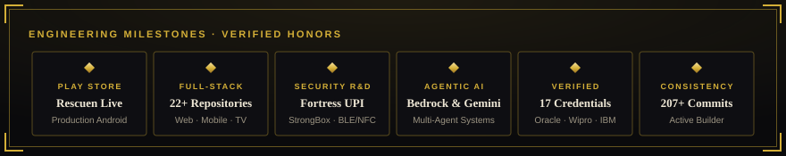
  </a>

  <br/><br/>

  <a href="https://github.com/bapanghosh0812">
    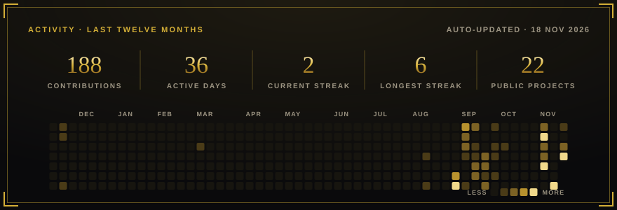
  </a>

  <br/><br/>

  <table width="100%">
    <tr>
      <td width="50%" align="center">
        <a href="https://github.com/bapanghosh0812?tab=repositories">
          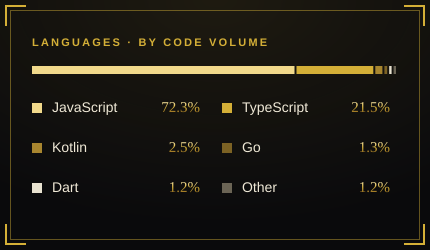
        </a>
      </td>
      <td width="50%" align="center">
        <a href="https://bapanghosh.netlify.app/">
          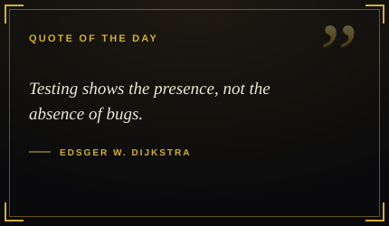
        </a>
      </td>
    </tr>
  </table>

  <br/>

  <p align="center">
    <sub><b>Contribution snake · refreshed by GitHub Actions</b></sub><br/>
    
  </p>

</div>

<details>
<summary><b>More live GitHub &amp; LeetCode cards</b></summary>
<br/>
<div align="center">
  <table width="100%">
    <tr>
      <td width="50%" align="center">
        
      </td>
      <td width="50%" align="center">
        
      </td>
    </tr>
    <tr>
      <td colspan="2" align="center">
        <a href="https://leetcode.com/u/BAPAN_GHOSH_07/" target="_blank">
          
        </a>
      </td>
    </tr>
  </table>
</div>
</details>

<div align="center">
  
</div>

## ✦ Arcade — Take a Break

<table width="100%">
  <tr>
    <td width="54%" valign="middle" align="center">
      <a href="https://wizard-chess-3d-by-bapan.netlify.app/" target="_blank">
        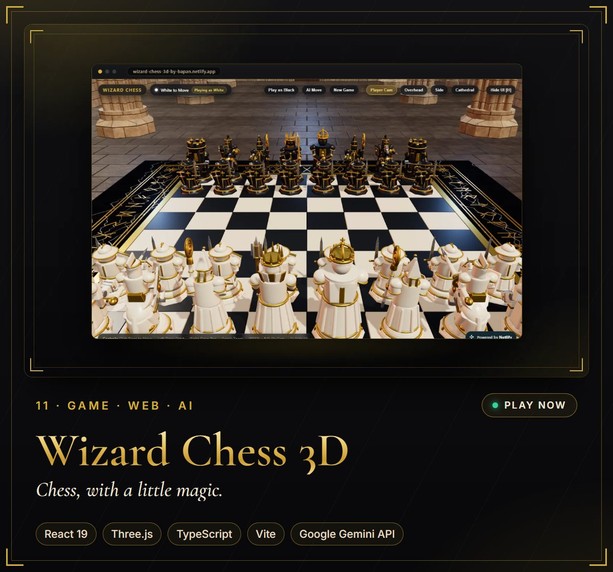
      </a>
      <p align="center">
        <a href="https://wizard-chess-3d-by-bapan.netlify.app/"><b>Play Wizard Chess 3D ↗</b></a> &nbsp;·&nbsp;
        <a href="https://github.com/bapanghosh0812/wizard-chess-3d"><b>Code ↗</b></a>
      </p>
    </td>
    <td width="46%" valign="middle" align="center">
      <h3>Community Tic-Tac-Toe</h3>
      <p><sub>Click any empty square to play <b>gold X</b>. A GitHub Action plays the bot's reply and updates this board automatically.</sub></p>

<!-- ARCADE:START -->
<div align="center">

**Your turn — click any open square to play gold X against the bot.**

  <table>
    <tr><td><a href="https://github.com/bapanghosh0812/bapanghosh0812/issues/new?title=ttt%7Cmove%7C0&body=Just+press+%2A%2ACreate%2A%2A+and+the+board+updates+in+about+a+minute.+You+can+close+this+tab."></a></td><td><a href="https://github.com/bapanghosh0812/bapanghosh0812/issues/new?title=ttt%7Cmove%7C1&body=Just+press+%2A%2ACreate%2A%2A+and+the+board+updates+in+about+a+minute.+You+can+close+this+tab."></a></td><td><a href="https://github.com/bapanghosh0812/bapanghosh0812/issues/new?title=ttt%7Cmove%7C2&body=Just+press+%2A%2ACreate%2A%2A+and+the+board+updates+in+about+a+minute.+You+can+close+this+tab."></a></td></tr>
    <tr><td><a href="https://github.com/bapanghosh0812/bapanghosh0812/issues/new?title=ttt%7Cmove%7C3&body=Just+press+%2A%2ACreate%2A%2A+and+the+board+updates+in+about+a+minute.+You+can+close+this+tab."></a></td><td></td><td><a href="https://github.com/bapanghosh0812/bapanghosh0812/issues/new?title=ttt%7Cmove%7C5&body=Just+press+%2A%2ACreate%2A%2A+and+the+board+updates+in+about+a+minute.+You+can+close+this+tab."></a></td></tr>
    <tr><td><a href="https://github.com/bapanghosh0812/bapanghosh0812/issues/new?title=ttt%7Cmove%7C6&body=Just+press+%2A%2ACreate%2A%2A+and+the+board+updates+in+about+a+minute.+You+can+close+this+tab."></a></td><td><a href="https://github.com/bapanghosh0812/bapanghosh0812/issues/new?title=ttt%7Cmove%7C7&body=Just+press+%2A%2ACreate%2A%2A+and+the+board+updates+in+about+a+minute.+You+can+close+this+tab."></a></td><td></td></tr>
  </table>

<sub>Games played <b>14</b> &nbsp;·&nbsp; Visitors won <b>6</b> &nbsp;·&nbsp; Bot won <b>5</b> &nbsp;·&nbsp; Draws <b>3</b></sub><br/>
<sub>Recent players: <a href="https://github.com/bapanghosh0812">@bapanghosh0812</a></sub><br/>
<sub><a href="https://github.com/bapanghosh0812/bapanghosh0812/issues/new?title=ttt%7Cnew&body=Just+press+%2A%2ACreate%2A%2A+and+the+board+updates+in+about+a+minute.+You+can+close+this+tab.">Start a fresh board</a></sub>

</div>
<!-- ARCADE:END -->

    </td>
  </tr>
</table>

<div align="center">
  
</div>

## ✦ Get in Touch

<details>
<summary><b>For recruiters &amp; hiring managers — quick answers</b></summary>
<br/>

- **Why should we hire Bapan?** Because he ships. Bapan co-built Rescuen and took it live on Google Play, completed two industry internships (Cognifyz, EDU TANTR), and has built 17 projects — 13 of them live — across web, Android, Fire TV, fintech and AI. His work comes with production habits most freshers skip: tests (184 in Vitrine alone), CSP and rate limits, CI/CD, Docker and Kubernetes. He learns fast and owns things end to end.
- **Is Bapan a fresher? Does he have real experience?** He graduates in 2027, so on paper he's a fresher — but not a typical one. He has two completed internships, an app live on the Google Play Store built with a teammate, and production-grade projects with real security, testing and deployment. His projects follow the same habits teams expect in production: tests, CI/CD, security headers, rate limits and real deployments.
- **When can he start?** Right away — for full-time roles or internships, remote or on-site. He graduates in June 2027 and is ready to join a team now.
- **Is he open to relocation?** Yes. He's based in Bankura, West Bengal and is happy to relocate anywhere in India — Bengaluru, Hyderabad, Pune, Gurugram/Noida, Chennai, Mumbai, Kolkata — or to work remotely.
- **What roles is he looking for?** Full-time Software Engineer / SDE roles, full-stack (React, Next.js, Node.js), mobile (React Native, Kotlin, Flutter) and backend/cloud roles — and he's equally happy to start with an internship.
- **Where's the résumé?** **[Bapan_Ghosh_Resume.pdf ↗](https://bapanghosh.netlify.app/Bapan_Ghosh_Resume.pdf)**
</details>

<br/>

<div align="center">

  <p>
    <b>Hiring for a full-time role or an internship — or have a project in mind?</b><br/>
    Reach out any time. I usually reply within a few hours.
  </p>

  <p>
    <a href="https://bapanghosh.netlify.app/" target="_blank"></a>&nbsp;
    <a href="https://play.google.com/store/apps/details?id=com.officialrescuen.app" target="_blank"></a>&nbsp;
    <a href="https://www.linkedin.com/in/bapan-ghosh-5676803a2/" target="_blank"></a>&nbsp;
    <a href="https://leetcode.com/u/BAPAN_GHOSH_07/" target="_blank"></a>&nbsp;
    <a href="https://bapanghosh.netlify.app/Bapan_Ghosh_Resume.pdf" target="_blank"></a>&nbsp;
    <a href="mailto:bapanghosh081204@gmail.com"></a>&nbsp;
    <a href="https://wa.me/919883290273?text=Hello%20Bapan!" target="_blank"></a>
  </p>

  <p>
    <a href="https://github.com/bapanghosh0812?tab=followers"></a>&nbsp;
    <a href="https://komarev.com/ghpvc/?username=bapanghosh0812"></a>
  </p>

  <p>
    <sub>Designed &amp; engineered by <b>Bapan Ghosh</b> · Bankura, West Bengal, India · <a href="https://bapanghosh.netlify.app/">bapanghosh.netlify.app</a></sub>
  </p>

</div>
