<div align="center">

  <a href="https://bapanghosh.netlify.app/">
    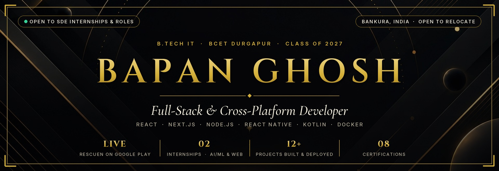
  </a>

  <br/><br/>

  <a href="https://bapanghosh.netlify.app/">
    
  </a>

  <br/>

  <p align="center">
    <a href="https://bapanghosh.netlify.app/" target="_blank"></a>&nbsp;
    <a href="https://play.google.com/store/apps/details?id=com.officialrescuen.app" target="_blank"></a>&nbsp;
    <a href="https://www.linkedin.com/in/bapan-ghosh-5676803a2/" target="_blank"></a>&nbsp;
    <a href="https://leetcode.com/u/BAPAN_GHOSH_07/" target="_blank"></a>&nbsp;
    <a href="https://bapanghosh.netlify.app/Bapan_Ghosh_Resume.pdf" target="_blank"></a>&nbsp;
    <a href="mailto:bapanghosh081204@gmail.com"></a>&nbsp;
    <a href="https://wa.me/919883290273?text=Hello%20Bapan!" target="_blank"></a>
  </p>

  <p align="center">
    <sub>
      <a href="#-about-me">About</a> &nbsp;·&nbsp;
      <a href="#-featured-work">Featured Work</a> &nbsp;·&nbsp;
      <a href="#-complete-project-index--live-demos">All Projects &amp; Demos</a> &nbsp;·&nbsp;
      <a href="#-system-architecture-notes">Architecture</a> &nbsp;·&nbsp;
      <a href="#-arcade--take-a-break">Play a Game</a> &nbsp;·&nbsp;
      <a href="#-skills--tech-stack">Tech Stack</a> &nbsp;·&nbsp;
      <a href="#-experience--journey">Journey</a> &nbsp;·&nbsp;
      <a href="#-activity--telemetry">Analytics</a> &nbsp;·&nbsp;
      <a href="#-certifications--credentials">Credentials</a> &nbsp;·&nbsp;
      <a href="#-get-in-touch">Contact</a>
    </sub>
  </p>

  

</div>

## 🏛️ About Me

I'm a final-year **B.Tech Information Technology** student at **Bengal College of Engineering and Technology (BCET), Durgapur** (Class of 2027) who likes building products end to end — from the interface and mobile client down to the API, database, and deployment.

- **Shipped to Google Play:** Co-built and launched **[Rescuen](https://play.google.com/store/apps/details?id=com.officialrescuen.app)** as a two-person team. I built the Android application (React Native + custom Kotlin native modules) featuring one-tap and triple-volume-key SOS, a 1 km geohash community radar, background location tracking, an encrypted evidence vault, and a Gemini safety assistant. Also built the official **[Rescuen Web](https://rescuen-web.netlify.app/)** platform in Next.js 15.
- **Full-Stack & Systems Depth:** Built **[College Campus](https://the-college-campus.netlify.app/)** (a verified campus social network with WebSockets, peer-to-peer WebRTC live video, Capacitor mobile builds, and Docker/Kubernetes manifests), **[Fortress UPI](https://github.com/bapanghosh0812/FORTRESS-UPI)** (an offline-capable UPI engine using Android StrongBox single-use hardware keys over BLE/NFC and Go settlement services), and **[Storyloom](https://github.com/bapanghosh0812/Fire-TV-Amazon)** (a 10-foot Amazon Fire TV family storytelling app on Amazon Bedrock AgentCore).
- **Industry Internships:** Completed a 4-month **AI/ML Internship at EDU TANTR** (Python model training & evaluation) and a **Web Development Internship at Cognifyz IT Solutions** (`ID: CTI/A1/C410735`).

| Snapshot | Details |
| :--- | :--- |
| **Current Status** | Open to **SDE / Full-Stack / Mobile Engineering Internships & 2027 Grad Roles** |
| **Base & Mobility** | Bankura, West Bengal, India · **Open to relocate anywhere in India or work remotely** |
| **Primary Stack** | `React 19` `Next.js 15` `TypeScript` `Node.js` `Express` `React Native` `Kotlin` `Go` `Python` `MongoDB` `PostgreSQL` `SQLite` `Firebase` `Docker` |
| **Spoken Languages** | English · Hindi · Bengali |
| **Direct Links** | [🌐 Live Portfolio](https://bapanghosh.netlify.app/) · [📄 Download Résumé (PDF)](https://bapanghosh.netlify.app/Bapan_Ghosh_Resume.pdf) · [📱 Google Play Store](https://play.google.com/store/apps/details?id=com.officialrescuen.app) |

<div align="center">
  
</div>

## ✦ Featured Work

<table width="100%">
  <tr>
    <td width="50%" valign="top">
      <a href="https://play.google.com/store/apps/details?id=com.officialrescuen.app" target="_blank">
        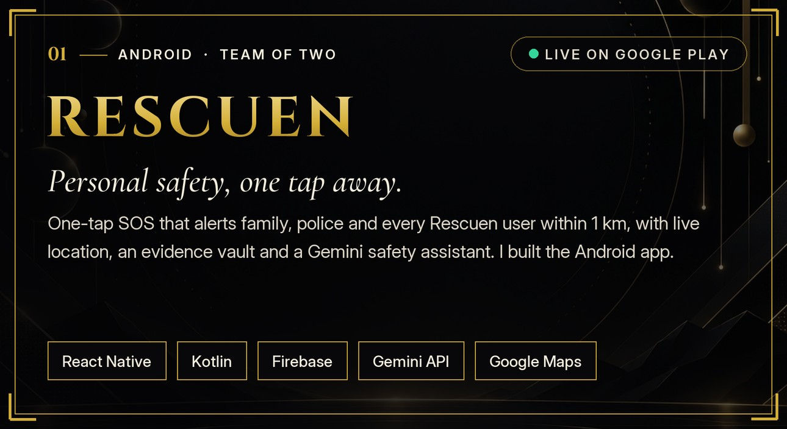
      </a>
      <p align="center">
        <a href="https://play.google.com/store/apps/details?id=com.officialrescuen.app"><b>📱 Google Play Store</b></a> &nbsp;·&nbsp;
        <a href="https://rescuen-web.netlify.app/"><b>🌐 Official Website</b></a> &nbsp;·&nbsp;
        <a href="https://github.com/bapanghosh0812/RESCUEN"><b>💻 Android Code</b></a> &nbsp;·&nbsp;
        <a href="https://github.com/bapanghosh0812/rescuen-web"><b>💻 Web Code</b></a>
      </p>
    </td>
    <td width="50%" valign="top">
      <a href="https://the-college-campus.netlify.app/" target="_blank">
        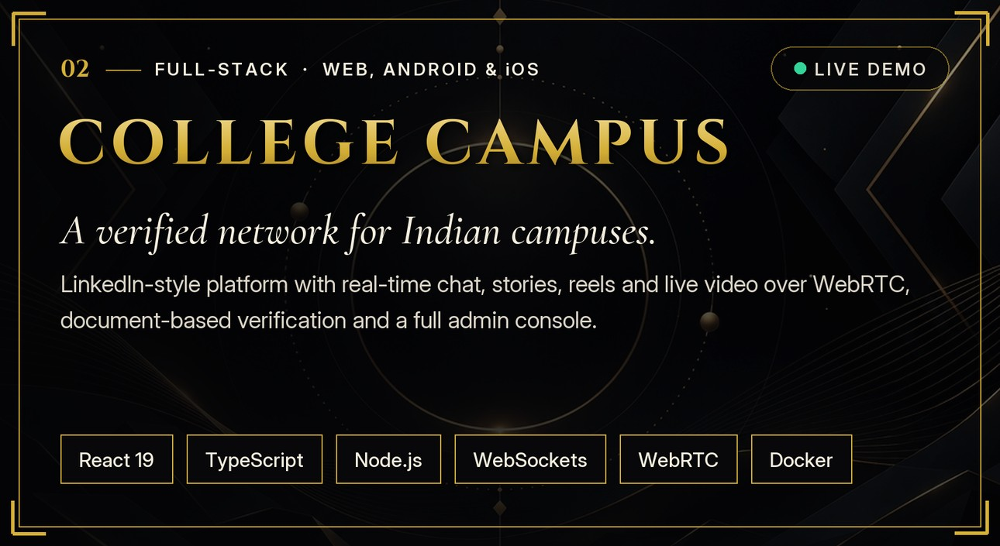
      </a>
      <p align="center">
        <a href="https://the-college-campus.netlify.app/"><b>🌐 Live Application</b></a> &nbsp;·&nbsp;
        <a href="https://github.com/bapanghosh0812/Social-App"><b>💻 Source Code</b></a>
      </p>
    </td>
  </tr>
  <tr>
    <td width="50%" valign="top">
      <a href="https://github.com/bapanghosh0812/FORTRESS-UPI" target="_blank">
        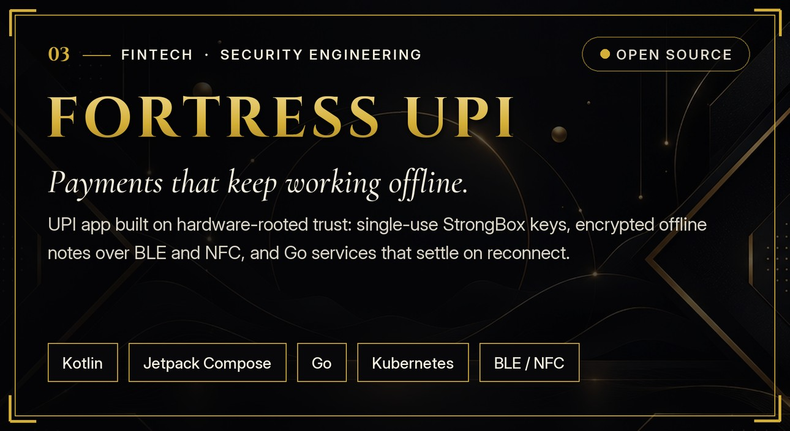
      </a>
      <p align="center">
        <a href="https://github.com/bapanghosh0812/FORTRESS-UPI"><b>💻 Source Code</b></a> &nbsp;·&nbsp;
        <a href="https://github.com/bapanghosh0812/FORTRESS-UPI/blob/main/docs/ARCHITECTURE.md"><b>📐 Architecture</b></a> &nbsp;·&nbsp;
        <a href="https://github.com/bapanghosh0812/FORTRESS-UPI/blob/main/docs/OFFLINE_PROTOCOL.md"><b>🔐 FOP/1 Protocol</b></a>
      </p>
    </td>
    <td width="50%" valign="top">
      <a href="https://github.com/bapanghosh0812/Fire-TV-Amazon" target="_blank">
        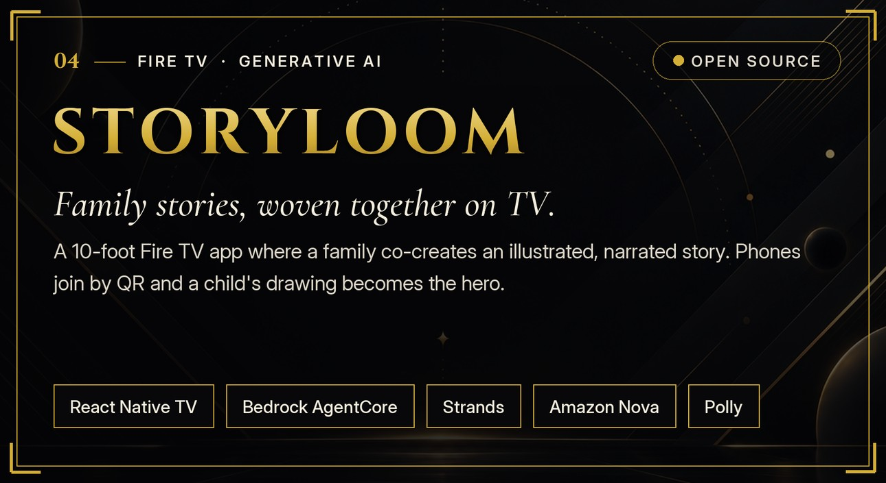
      </a>
      <p align="center">
        <a href="https://github.com/bapanghosh0812/Fire-TV-Amazon"><b>💻 Source Code &amp; Architecture</b></a>
      </p>
    </td>
  </tr>
  <tr>
    <td width="50%" valign="top">
      <a href="https://official-wearsuper-cloth-store.netlify.app/" target="_blank">
        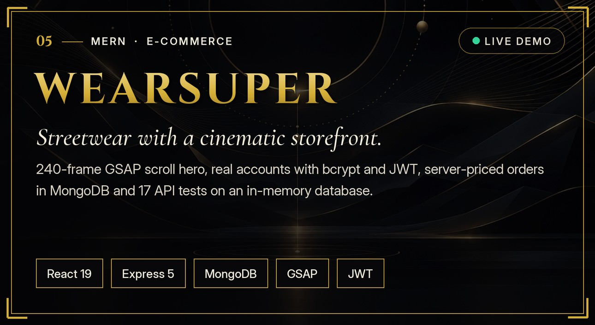
      </a>
      <p align="center">
        <a href="https://official-wearsuper-cloth-store.netlify.app/"><b>🌐 Live Storefront</b></a> &nbsp;·&nbsp;
        <a href="https://github.com/bapanghosh0812/cloth"><b>💻 Source Code</b></a>
      </p>
    </td>
    <td width="50%" valign="top">
      <a href="https://children-s-coloring-book-generator.netlify.app/" target="_blank">
        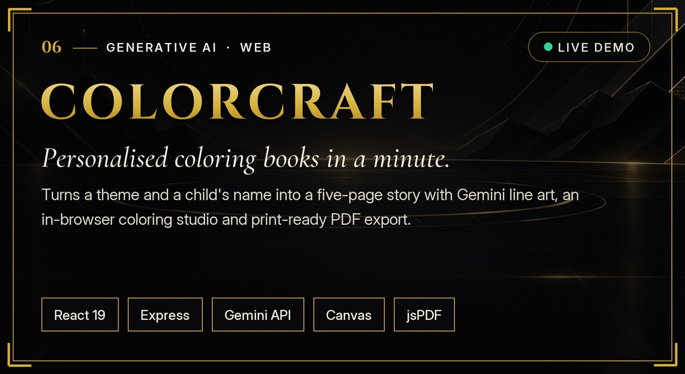
      </a>
      <p align="center">
        <a href="https://children-s-coloring-book-generator.netlify.app/"><b>🌐 Live Studio</b></a> &nbsp;·&nbsp;
        <a href="https://github.com/bapanghosh0812/Children-s-Coloring-Book-Generator"><b>💻 Source Code</b></a>
      </p>
    </td>
  </tr>
</table>

<div align="center">
  
</div>

## 📂 Complete Project Index & Live Demos

Every public project I've built, with direct links to the live deployment and repository:

| # | Project | Category | What I Built & Key Engineering Details | Tech Stack | Live Demo / Store | Source Code |
| :-: | :--- | :--- | :--- | :--- | :---: | :---: |
| **01** | **Rescuen** *(Android)* | Mobile · Safety | Production emergency response app: 1-tap & triple-volume-key lock-screen SOS, 1 km geohash community radar, foreground location tracking, Follow-Me dead-man's switch, PIN-locked Evidence Vault, and Gemini AI safety assistant. | `React Native` `Kotlin` `TypeScript` `Firebase` `FCM` `Geohash` `Gemini API` `Notifee` | [📱 Play Store](https://play.google.com/store/apps/details?id=com.officialrescuen.app) | [Repo](https://github.com/bapanghosh0812/RESCUEN) |
| **02** | **Rescuen Web** | Full-Stack Web | Official web platform for Rescuen with passwordless phone OTP sign-in (Firebase Admin), server-side Gemini safety companion, automated SMTP contact center, and CSP/Zod hardening. | `Next.js 15` `React 19` `TypeScript` `Tailwind` `Firebase Admin` `Gemini` `Nodemailer` | [🌐 Netlify](https://rescuen-web.netlify.app/) · [Vercel](https://rescuen-web.vercel.app) | [Repo](https://github.com/bapanghosh0812/rescuen-web) |
| **03** | **College Campus** | Full-Stack · Mobile | Verified network for Indian colleges: document ID verification queue, trigram search, real-time DMs over WebSockets, peer-to-peer WebRTC live video, reels, stories, and placement board. Runs on Web, Android & iOS. | `React 19` `TypeScript` `Node.js` `Express` `SQLite` `WebSockets` `WebRTC` `Capacitor` `Docker` `K8s` | [🌐 Live App](https://the-college-campus.netlify.app/) | [Repo](https://github.com/bapanghosh0812/Social-App) |
| **04** | **Fortress UPI** | Fintech · Security | Dual offline & online UPI platform: hardware-attested keys in Android StrongBox/TEE (`setMaxUsageCount(1)`), encrypted offline vouchers over BLE/NFC (`FOP/1`), and Go 1.27 clearing microservices (`p99 < 15ms`). | `Kotlin` `Jetpack Compose` `Android StrongBox` `Swift` `Go` `BLE / NFC` `Docker` `Kubernetes` | [📐 Docs](https://github.com/bapanghosh0812/FORTRESS-UPI/blob/main/docs/ARCHITECTURE.md) | [Repo](https://github.com/bapanghosh0812/FORTRESS-UPI) |
| **05** | **Storyloom** | Living Room TV · AI | 10-foot Amazon Fire TV app where families weave illustrated, narrated stories together. Phones join via QR code, children snap paper drawings into characters, and Bedrock Guardrails enforce family safety. | `React Native TV` `TypeScript` `Bedrock AgentCore` `Strands` `Amazon Nova` `Stability AI` `AWS Polly` | — | [Repo](https://github.com/bapanghosh0812/Fire-TV-Amazon) |
| **06** | **WEARSUPER** | MERN E-Commerce | Luxury streetwear storefront with a 240-frame GSAP ScrollTrigger hero, 360° product viewer, bcrypt + JWT auth, server-recalculated MongoDB orders, 20-minute cancellation window, and 17 Supertest API tests. | `React 19` `Vite` `Tailwind v4` `GSAP` `Node.js` `Express 5` `MongoDB` `JWT` `Supertest` | [🌐 Live Store](https://official-wearsuper-cloth-store.netlify.app/) | [Repo](https://github.com/bapanghosh0812/cloth) |
| **07** | **ColorCraft** | Generative AI · Web | Turns a child's name and theme into a personalized 5-page story with Gemini black-and-white line art, model fallback chain, interactive HTML5 Canvas coloring studio, and one-click jsPDF export. | `React 19` `TypeScript` `Node.js` `Express` `Google Gemini API` `HTML5 Canvas` `jsPDF` | [🌐 Live Studio](https://children-s-coloring-book-generator.netlify.app/) | [Repo](https://github.com/bapanghosh0812/Children-s-Coloring-Book-Generator) |
| **08** | **Wizard Chess 3D** | 3D Browser Game | Interactive 3D chess game rendered in the browser with Three.js, camera orbit controls, legal move validation, and AI opponent integration. | `React 19` `Three.js` `JavaScript` `Gemini API` `Vite` | [🎮 Play (Netlify)](https://wizard-chess-3d-by-bapan.netlify.app/) · [Vercel](https://wizard-chess-3d-one.vercel.app) | [Repo](https://github.com/bapanghosh0812/wizard-chess-3d) |
| **09** | **Mini ChatGPT** | Multi-Agent AI | Two-agent pipeline chaining a Research Agent and a Summarizer Agent on Google Gemini with language detection, auto-translation, rolling context memory, and FPDF conversation export. | `Python` `Streamlit` `Google Gemini API` `Multi-Agent` `langdetect` `FPDF` | — | [Repo](https://github.com/bapanghosh0812/Chatbot-or-mini-Chatgpt) |
| **10** | **Face Mask Detection** | Computer Vision | Real-time webcam face-mask detector using OpenCV Haar cascades and a fine-tuned MobileNetV2 transfer-learning classifier trained in TensorFlow/Keras. | `Python` `TensorFlow` `Keras` `MobileNetV2` `OpenCV` `NumPy` `scikit-learn` | — | [Repo](https://github.com/bapanghosh0812/Face_mask_detection) |
| **11** | **GhoshKart** | WebAuthn E-Commerce | Multi-page e-commerce storefront built in vanilla ES6+ JavaScript featuring biometric passkey/fingerprint login via the Web Authentication (`WebAuthn`) API, catalog filters, and UPI checkout flow. | `JavaScript (ES6+)` `WebAuthn API` `Web Crypto API` `HTML5` `CSS3` | [🌐 Live Store](https://e-commerce-site-by-bapanghosh.netlify.app/) | [Repo](https://github.com/bapanghosh0812/E-commerce-Site) |
| **12** | **Online Exam System** | EdTech Platform | Browser-based assessment portal with separate student and admin dashboards, countdown timer with auto-submission, instant grading, printable grade cards, and EmailJS password recovery. | `JavaScript (ES6+)` `HTML5` `CSS3` `EmailJS` `localStorage` | [🌐 Live Portal](https://onlineexaminationsystems7.netlify.app/) | [Repo](https://github.com/bapanghosh0812/Online-exam-system) |
| **13** | **CutSlot** | Mobile Booking | Salon partner and appointment booking client for managing chair availability, time slots, and customer bookings. | `Flutter` `Dart` `C++` `Material Design` | — | [Repo](https://github.com/bapanghosh0812/cutslot) |
| **14** | **Job Discovery Portal** | Career Directory | Curated job search directory indexing engineering roles across startups, mid-sized firms, and enterprise companies. | `JavaScript` `HTML5` `CSS3` | [🌐 Live Portal](https://job-list-by-bapanghosh.netlify.app/) | [Repo](https://github.com/bapanghosh0812/Jobs-in-all-Low-to-High-companies) |
| **15** | **Developer Portfolios & Suites** | Web Engineering | Interactive 3D developer portfolio (`bapanghosh.netlify.app`), secondary static portfolio, Note-Taking web app, and Cognifyz internship project suite. | `JavaScript` `Three.js` `HTML5` `CSS3` `Bootstrap` | [🌐 Portfolio 1](https://bapanghosh.netlify.app/) · [Portfolio 2](https://bapanghosh0812.github.io/portfolio-2/) | [Portfolio](https://github.com/bapanghosh0812/portfolio) · [Cognifyz](https://github.com/bapanghosh0812/cognifyz-Internship-Tasks) · [Notes](https://github.com/bapanghosh0812/Note-Taking-App) |

<div align="center">
  
</div>

## 📐 System Architecture Notes

Expand any project below to inspect how the system is wired under the hood:

<details>
<summary><b>01 · Rescuen — Android Native SOS &amp; 1 km Geohash Community Radar</b></summary>
<br/>

```text
[ Android Client: React Native + Custom Kotlin Native Module ]
  ├── Triple Volume-Key Hardware Listener (works with screen locked)
  ├── Foreground Location Service (continuous GPS telemetry with wake lock)
  └── Camera + Mic Recorder ──► PIN-Locked Owner-Only Cloud Evidence Vault
        │
        ▼
[ Emergency Dispatch Pipeline (Firebase + Google Cloud) ]
  ├── 1. Geohash Proximity Query ──► FCM high-priority push to Rescuen users within 1 km
  ├── 2. Direct SMS + 112 / 100  ──► Live Google Maps route sent to 5 family contacts
  ├── 3. Follow-Me Watchdog      ──► Dead-man's switch prompts "Are you safe?" on sudden stops
  └── 4. Gemini Safety Assistant ──► Server-side function calling to trigger SOS or guide first aid
```
</details>

<details>
<summary><b>02 · College Campus — Real-Time Messaging, WebRTC Live Video &amp; Document Verification</b></summary>
<br/>

```text
[ Web (React 19 + Vite) ]  &  [ Android / iOS (Capacitor) ]
                     │
                     ▼  (Nginx Reverse Proxy · Helmet CSP/HSTS · Rate Limiter)
         [ Node.js + Express API Server ]
          ├── Auth: bcrypt + Revocable JWT + Google OAuth 2.0
          ├── Search: Typo-tolerant trigram similarity across users, colleges & posts
          ├── Real-Time Hub: Single multiplexed WebSocket channel (DMs, typing, receipts, alerts)
          ├── Live Broadcast: Peer-to-Peer WebRTC video stream + real-time chat & reactions
          ├── Storage: SQLite (better-sqlite3) + In-Memory TTL Cache + AWS S3 (signed expiring URLs)
          └── Deploy: Docker Compose & Kubernetes manifests (Deployment, Service, Ingress, PVC)
```
</details>

<details>
<summary><b>03 · Fortress UPI — Hardware-Attested Offline Payment Protocol (FOP/1)</b></summary>
<br/>

```text
[ Payer Phone (Offline) ]                         [ Payee Phone (Offline) ]
┌───────────────────────────────────┐             ┌───────────────────────────────────┐
│ Android StrongBox / iOS Enclave   │             │ BLE Central / NFC Reader          │
│ • Hardware ECDSA P-256 keypair    │ 1. BLE/NFC  │ • Ephemeral ECDH session handshake│
│ • Single-use note key:            ├────────────►│ • AES-256-GCM payload verification│
│   setMaxUsageCount(1)             │◄────────────┤ • Stores signed offline voucher   │
└─────────────────┬─────────────────┘ 2. Receipt  └─────────────────┬─────────────────┘
                  └───────────────────────┬─────────────────────────┘
                                          ▼  (When either phone regains connectivity)
                  [ Fortress Clearing Mesh (Go 1.27 · stdlib-only · Distroless) ]
                   • Hardware key certificate-chain attestation check
                   • Nonce de-duplication & ledger settlement (p99 < 15 ms gate)
```
</details>

<details>
<summary><b>04 · Storyloom — Amazon Fire TV 10-Foot UI &amp; Multi-Agent Story Engine</b></summary>
<br/>

```text
[ Phones (Join via QR · No App Install) ] ──► Snap paper drawing / speak story twist
                                                      │
                                                      ▼
[ Amazon Bedrock AgentCore Runtime + Strands Multi-Agent Pipeline ]
  ├── Director Agent (Amazon Nova 2 Lite) ──► Structured multi-scene story arc
  ├── Illustration Pipeline (Stability AI) ──► Turns child's sketch into storybook art
  ├── Safety Layer (Bedrock Guardrails)    ──► Filters prompts & auto-deletes photos in 24h
  └── Narration Stream (AWS Polly)         ──► Word-by-word synced read-along audio
                                                      │
                                                      ▼
[ Amazon Fire TV Stick (React Native for TV · D-Pad Spatial Focus · Family Vote) ]
```
</details>

<details>
<summary><b>05 · WEARSUPER — Server-Priced MERN Checkout &amp; Automated API Test Suite</b></summary>
<br/>

```text
[ React 19 Storefront ]
  • 240-frame progressive GSAP ScrollTrigger sequence (120-frame mobile profile)
  • Interactive 360° drag-to-rotate product inspection & wishlist
        │
        ▼  (REST + Bearer JWT · Helmet · CORS Allow-List · Login Rate Limiter)
[ Express 5 + Mongoose API ]
  • Server-side price recalculation (never trusts client cart totals)
  • Atomic order, tracking & invoice generation + 20-minute cancellation enforcement
  • Verified by 17 automated integration tests (Node Test Runner + Supertest + mongodb-memory-server)
```
</details>

<div align="center">
  
</div>

## 🎮 Arcade — Take a Break

Whether you have thirty seconds or five minutes, you can play a game right here:

<table width="100%">
  <tr>
    <td width="54%" valign="middle" align="center">
      <a href="https://wizard-chess-3d-by-bapan.netlify.app/" target="_blank">
        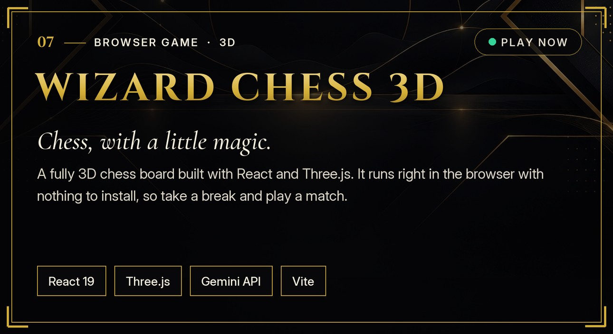
      </a>
      <p align="center">
        <a href="https://wizard-chess-3d-by-bapan.netlify.app/"><b>♟️ Launch 3D Chess in Browser (Netlify)</b></a> &nbsp;·&nbsp;
        <a href="https://wizard-chess-3d-one.vercel.app"><b>⚡ Vercel Mirror</b></a> &nbsp;·&nbsp;
        <a href="https://github.com/bapanghosh0812/wizard-chess-3d"><b>💻 Code</b></a>
      </p>
    </td>
    <td width="46%" valign="middle" align="center">
      <h3>⚔️ Community Tic-Tac-Toe</h3>
      <p><sub>Click any empty square below to play <b>Gold X</b>. A GitHub Action makes the bot's reply and updates this README automatically.</sub></p>

<!-- ARCADE:START -->
<div align="center">

**Your turn — click any open square to play gold X against the bot.**

  <table>
    <tr><td><a href="https://github.com/bapanghosh0812/bapanghosh0812/issues/new?title=ttt%7Cmove%7C0&body=Just+press+%2A%2ACreate%2A%2A+and+the+board+updates+in+about+a+minute.+You+can+close+this+tab."></a></td><td><a href="https://github.com/bapanghosh0812/bapanghosh0812/issues/new?title=ttt%7Cmove%7C1&body=Just+press+%2A%2ACreate%2A%2A+and+the+board+updates+in+about+a+minute.+You+can+close+this+tab."></a></td><td><a href="https://github.com/bapanghosh0812/bapanghosh0812/issues/new?title=ttt%7Cmove%7C2&body=Just+press+%2A%2ACreate%2A%2A+and+the+board+updates+in+about+a+minute.+You+can+close+this+tab."></a></td></tr>
    <tr><td><a href="https://github.com/bapanghosh0812/bapanghosh0812/issues/new?title=ttt%7Cmove%7C3&body=Just+press+%2A%2ACreate%2A%2A+and+the+board+updates+in+about+a+minute.+You+can+close+this+tab."></a></td><td></td><td><a href="https://github.com/bapanghosh0812/bapanghosh0812/issues/new?title=ttt%7Cmove%7C5&body=Just+press+%2A%2ACreate%2A%2A+and+the+board+updates+in+about+a+minute.+You+can+close+this+tab."></a></td></tr>
    <tr><td><a href="https://github.com/bapanghosh0812/bapanghosh0812/issues/new?title=ttt%7Cmove%7C6&body=Just+press+%2A%2ACreate%2A%2A+and+the+board+updates+in+about+a+minute.+You+can+close+this+tab."></a></td><td><a href="https://github.com/bapanghosh0812/bapanghosh0812/issues/new?title=ttt%7Cmove%7C7&body=Just+press+%2A%2ACreate%2A%2A+and+the+board+updates+in+about+a+minute.+You+can+close+this+tab."></a></td><td></td></tr>
  </table>

<sub>Games played <b>14</b> &nbsp;·&nbsp; Visitors won <b>6</b> &nbsp;·&nbsp; Bot won <b>5</b> &nbsp;·&nbsp; Draws <b>3</b></sub><br/>
<sub>Recent players: <a href="https://github.com/bapanghosh0812">@bapanghosh0812</a></sub><br/>
<sub><a href="https://github.com/bapanghosh0812/bapanghosh0812/issues/new?title=ttt%7Cnew&body=Just+press+%2A%2ACreate%2A%2A+and+the+board+updates+in+about+a+minute.+You+can+close+this+tab.">Start a fresh board</a></sub>

</div>
<!-- ARCADE:END -->

    </td>
  </tr>
</table>

<div align="center">
  
</div>

## 🛠️ Skills & Tech Stack

<div align="center">
  <p>
    <br/>
    <br/>
    
  </p>
</div>

| Layer | Technologies I Work With | Where I've Used Them |
| :--- | :--- | :--- |
| **Frontend & Motion** | `React 19` `Next.js 15` `TypeScript` `JavaScript (ES6+)` `Tailwind CSS` `Three.js` `GSAP ScrollTrigger` `Framer Motion` `Zustand` `Vite` `HTML5 Canvas` | College Campus, WEARSUPER, Rescuen Web, ColorCraft, Wizard Chess 3D |
| **Backend & Real-Time** | `Node.js` `Express 5` `Go` `REST APIs` `WebSockets` `WebRTC` `JWT / OAuth 2.0` `WebAuthn` `Zod` `Helmet` `Nodemailer` `Supertest` | College Campus, Fortress UPI, WEARSUPER, Rescuen Web, GhoshKart |
| **Databases & Storage** | `MongoDB (Mongoose)` `PostgreSQL` `SQLite (better-sqlite3)` `Cloud Firestore` `Redis` `AWS S3` | WEARSUPER, College Campus, Rescuen |
| **Mobile & Living Room TV** | `React Native` `Kotlin` `Jetpack Compose` `Android StrongBox / TEE` `React Native for TV` `Capacitor` `Flutter` `BLE / NFC` | Rescuen (Google Play), Fortress UPI, Storyloom (Fire TV), CutSlot |
| **Cloud, DevOps & Testing** | `Docker` `Kubernetes` `GitHub Actions` `Nginx` `AWS (Bedrock, Polly, S3, EC2)` `Firebase` `Netlify` `Vercel` `Render` | CI/CD pipelines, containerized APIs, production web & mobile releases |
| **AI / ML & Core CS** | `Python` `Google Gemini API` `Amazon Bedrock AgentCore` `Strands Agents` `TensorFlow / Keras` `OpenCV` `Streamlit` `C++` `DSA` `OOP` `DBMS` `OS` `CN` | Storyloom, Rescuen AI Assistant, ColorCraft, Mini ChatGPT, Face Mask Detection |

<div align="center">
  
</div>

## 🧭 Experience & Journey

| Period | Role / Milestone | Organization | Highlights |
| :--- | :--- | :--- | :--- |
| **2026** | **Co-Creator & Android Lead — Rescuen** | **Google Play Store Release** | Built and shipped the production Android safety app (`com.officialrescuen.app`) with custom Kotlin native lock-screen triggers, 1 km geohash community alerts, background GPS service, and Gemini AI safety assistant. |
| **Aug 2026 – Sep 2026** | **Web Development Intern** | **Cognifyz IT Solutions Pvt. Ltd.** | Completed all three progressive engineering task levels across responsive interfaces, interactive JavaScript utilities, and full-stack components (`Ref: CTI/A1/C410735`). |
| **Aug 2025 – Nov 2025** | **AI / ML Intern** | **EDU TANTR** | Completed a 4-month structured internship building, training, and evaluating machine-learning pipelines and applied Python mini-projects. |
| **Aug 2023 – Jun 2027** | **B.Tech in Information Technology** | **BCET Durgapur (MAKAUT)** | Final-year undergraduate focusing on software engineering, data structures & algorithms, operating systems, database systems, and computer networks. |

<div align="center">
  
</div>

## 📊 Activity & Telemetry

<div align="center">

  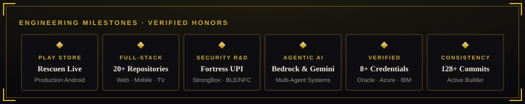

  <br/><br/>

  

  <br/><br/>

  <table width="100%">
    <tr>
      <td width="50%" align="center">
        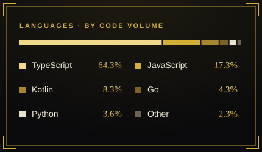
      </td>
      <td width="50%" align="center">
        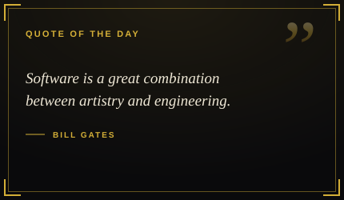
      </td>
    </tr>
  </table>

  <br/>

  <p align="center">
    <sub><b>🐍 24/7 Contribution Snake (Refreshed Daily via GitHub Actions)</b></sub><br/>
    
  </p>

</div>

<details>
<summary><b>📈 View Additional Live GitHub &amp; LeetCode Telemetry Cards</b></summary>
<br/>
<div align="center">
  <table width="100%">
    <tr>
      <td width="50%" align="center">
        
      </td>
      <td width="50%" align="center">
        
      </td>
    </tr>
    <tr>
      <td colspan="2" align="center">
        <a href="https://leetcode.com/u/BAPAN_GHOSH_07/" target="_blank">
          
        </a>
      </td>
    </tr>
  </table>
</div>
</details>

<div align="center">
  
</div>

## 🎖️ Certifications & Credentials

All certificates and verification badges are available to inspect on my **[live portfolio](https://bapanghosh.netlify.app/#certificates)**:

| Credential / Certification | Issuing Body | Date | Verification / Reference ID |
| :--- | :--- | :---: | :--- |
| **OCI Generative AI Certified Professional** | Oracle Cloud Infrastructure | Oct 2025 | `102959402OCI25GAIOCP` |
| **Agentic AI Certified Foundations Associate** | Oracle | Sep 2026 | `102959402AAI26OFA` |
| **Microsoft Certified: Azure Fundamentals (AZ-900)** | Microsoft | Dec 2024 | `1D7710EDBE9E1561` |
| **AI Fundamentals & Applied Capstone** | IBM SkillsBuild | Oct 2025 | `IBM SkillsBuild Verified` |
| **5-Day AI Agents Intensive Program** | Google & Kaggle | 2025 | `Kaggle x Google Badge` |
| **Web Development Internship Certificate** | Cognifyz IT Solutions Pvt. Ltd. | Sep 2026 | `CTI/A1/C410735` |
| **AI / ML Internship & Course Completion** | EDU TANTR | Nov 2025 | `4-Month Structured Internship` |
| **Data Structures using C Assessment** | PVG's College of Engineering, Nashik | Dec 2024 | `CPIZG8-CE034206` |
| **DataSculpt International STTP (ML & Data Science)** | BCET Durgapur (Dept. of IT & CSE) | Mar 2024 | `Departmental Credential` |
| **Python Coder & Dataset Creator Badges** | Kaggle | Nov 2025 | `Kaggle Verified` |

<div align="center">
  
</div>

## 📬 Get In Touch

<details>
<summary><b>💼 For Recruiters &amp; Hiring Managers — Quick Hiring FAQ</b></summary>
<br/>

- **What roles are you looking for?** Software Development Engineer (SDE), Full-Stack Developer (React / Next.js / Node.js), Mobile Engineer (React Native / Kotlin), or Backend / Cloud Intern & 2027 New-Grad roles.
- **When can you start?** Available immediately for full-time or part-time internships, and graduating in **June 2027** for full-time SDE roles.
- **Are you open to relocation?** Yes — based in Bankura, West Bengal and happy to relocate to Bengaluru, Hyderabad, Pune, Gurugram/Noida, Chennai, Mumbai, Kolkata, or work remotely.
- **Where can I grab your résumé?** Direct PDF link: **[Bapan_Ghosh_Resume.pdf](https://bapanghosh.netlify.app/Bapan_Ghosh_Resume.pdf)**
</details>

<br/>

<div align="center">

  <p>
    <b>Looking for a developer who ships complete products from UI to backend and Play Store release?</b><br/>
    Reach out anytime — I usually reply within a few hours.
  </p>

  <p>
    <a href="https://bapanghosh.netlify.app/" target="_blank"></a>&nbsp;
    <a href="https://bapanghosh.netlify.app/Bapan_Ghosh_Resume.pdf" target="_blank"></a>&nbsp;
    <a href="https://www.linkedin.com/in/bapan-ghosh-5676803a2/" target="_blank"></a>&nbsp;
    <a href="mailto:bapanghosh081204@gmail.com"></a>&nbsp;
    <a href="https://wa.me/919883290273?text=Hello%20Bapan!" target="_blank"></a>&nbsp;
    <a href="https://play.google.com/store/apps/details?id=com.officialrescuen.app" target="_blank"></a>
  </p>

  <p>
    <a href="https://github.com/bapanghosh0812?tab=followers"></a>&nbsp;
    <a href="https://komarev.com/ghpvc/?username=bapanghosh0812"></a>
  </p>

  <p>
    <sub>Built by <b>Bapan Ghosh</b> · Bankura, West Bengal, India · <a href="https://bapanghosh.netlify.app/">bapanghosh.netlify.app</a></sub>
  </p>

</div>
